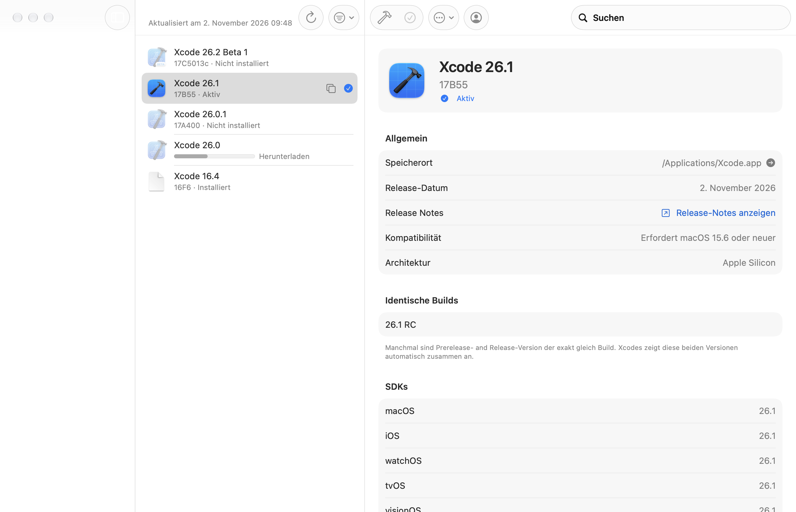
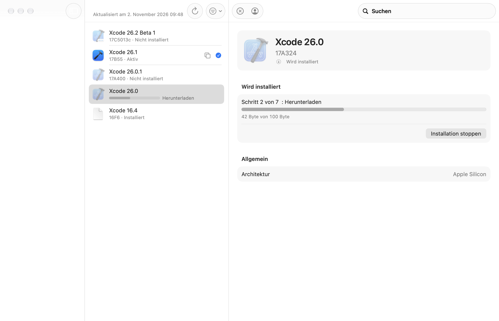

# Xcodes – UI-Konzept nach den Apple Human Interface Guidelines

## 1. Befund: Was an der bisherigen Oberfläche nicht stimmt

| # | Problem | Verstoßene HIG-Regel |
|---|---------|----------------------|
| 1 | Die Seitenleiste enthält keine Navigation, sondern den eigentlichen Inhalt (die Xcode-Liste). Filter („Nur Betas“, „Nur installierte“) stecken in einem Menü. | *Sidebars*: Die Seitenleiste dient der Navigation zwischen Bereichen der App, nicht als Inhaltsliste. |
| 2 | Jede Zeile trägt einen großen, blauen Kapsel-Button „INSTALL“/„OPEN“ im App-Store-Stil, in Großbuchstaben. | *Buttons*, *Typography*: macOS-Buttons verwenden Title Case bzw. Satzschreibung, keine Versalien; *Lists and tables*: Zeilen sollen ruhig sein, Aktionen gehören in Toolbar, Kontextmenü und Menüleiste. Ein Klick auf „INSTALL“ startet ohne Rückfrage einen Download von mehreren Gigabyte. |
| 3 | Klickbare, nur per Tooltip erklärte Häkchen-Icons in grün/gelb/grau zum Aktivieren einer Version. | *Accessibility / Color*: Status darf nicht nur über Farbe vermittelt werden; versteckte Aktionen hinter unbeschrifteten Icons sind schwer auffindbar. |
| 4 | Detailbereich aus selbst gebauten weißen Karten mit 5-pt-Radius, verteilt auf zwei Spalten mit fester Breite; Daten als Fließtext („macOS: 14.4\niOS: 17.4“). | *Layout*, *Forms*: Für strukturierte Informationen bietet macOS gruppierte Formulare mit Beschriftung/Wert-Paaren (`Form` + `LabeledContent`). Eigene Kartenstile passen nicht zum System und brechen bei schmalen Fenstern. |
| 5 | Permanente Statusleiste am Fensterrand mit Spenden-Button und Versionsnummer; die Statusmeldung darin war nur bis WWDC 2022 befüllt. | *Windows*: Fensterinhalt soll der Aufgabe dienen; App-Version gehört in „Über Xcodes“, Unterstützungs-Links ins Hilfe-Menü. |
| 6 | Einstellungen-Zahnrad in der Toolbar. | *Settings*: Einstellungen öffnet man auf dem Mac über das App-Menü (⌘,). |
| 7 | „Installed Platforms“ als großer Button unten in der Seitenleiste, der ein separates Fenster öffnet. | *Sidebars*: Seitenleisteneinträge navigieren, sie öffnen keine Fenster. Hilfsfenster gehören ins Fenster-Menü. |
| 8 | Laufende Installationen zeigen nur einen winzigen Spinner + Fußnote in der Zeile. | *Progress indicators*: Bestimmte Fortschritte als Balken mit Prozentangabe zeigen. |
| 9 | Deinstallieren bestätigt per altem `Alert`; der destruktive Button im Detailbereich ist nur rot eingefärbt. | *Alerts / Action sheets*: Destruktive Aktionen mit `confirmationDialog` und `.destructive`-Rolle. |
| 10 | Leerer Zustand ist ein grauer Titel mitten im Fenster. | *Empty states*: `ContentUnavailableView` mit Symbol und erklärendem Text. |

## 2. Leitlinien für das neue Design

1. **Systemkomponenten statt Eigenbau.** `NavigationSplitView`, `List`, `Form(.grouped)`, `LabeledContent`, `ContentUnavailableView`, Standard-Toolbar, Standard-Buttons. Dadurch passen Dark Mode, erhöhter Kontrast, Liquid Glass (macOS 26), Dynamic Type und VoiceOver automatisch.
2. **Navigation – Inhalt – Details.** Klassischer Dreispalter wie Mail, Notizen oder der App Store.
3. **Aktionen dort, wo Mac-Nutzer sie erwarten:** Toolbar (häufigste Aktionen der aktuellen Auswahl), Kontextmenü, Menüleiste mit Tastaturkürzeln, Doppelklick zum Öffnen.
4. **Status immer mit Text + Symbol**, Farbe nur zusätzlich.
5. **Ruhige Listenzeilen**, keine Buttons in der Zeile.

## 3. Fensteraufbau

```
┌───────────────┬───────────────────────────┬──────────────────────────────────────┐
│ ● ● ●         │  ⟳  ⧩            🔍 Suche │  ⬇︎ Installieren  ✓ Aktivieren  ⋯  👤  │
├───────────────┼───────────────────────────┼──────────────────────────────────────┤
│ XCODE         │ [icon] Xcode 26.1   ✓     │  [ICON]  Xcode 26.1                  │
│  ▣ Alle   42  │        17B55 · Aktiv      │          17B55                       │
│  ▣ Releases   │ [icon] Xcode 26.1 RC      │          ✓ Aktiv                     │
│  ▣ Betas      │        17B54 · Nicht inst.│ ──────────────────────────────────── │
│  ▣ Installiert│ [icon] Xcode 26.0.1       │  Allgemein                           │
│               │        17A400 · Inst.     │   Speicherort   /Applications/…  ➜   │
│               │ [icon] Xcode 26.0         │   Veröffentlicht 3. Nov. 2025  ↗     │
│               │        ▓▓▓▓░░░ 42 %       │   Kompatibilität macOS 15.6 oder neuer│
│               │                           │   Architektur   Apple Silicon         │
│               │                           │  Plattformen               [Arch ▾]  │
│               │                           │   📱 iOS 26.1        8,1 GB [Laden]   │
│               │                           │   ⌚ watchOS 26.1     ✓ Installiert   │
│               │                           │  SDKs                                │
│               │                           │   macOS          26.1                │
│               │                           │  Compiler                            │
│               │                           │   Swift          6.2.1               │
└───────────────┴───────────────────────────┴──────────────────────────────────────┘
```

### 3.1 Seitenleiste (Navigation)

* Abschnitt **„Xcode“** mit den Bereichen **Alle**, **Releases**, **Betas**, **Installiert** – jeweils mit SF Symbol und Anzahl als Badge.
* Ersetzt die bisherigen Kategorie- und „Nur installierte“-Filter im Menü. Per MDM gesperrte Kategorien bleiben wählbar, solange sie der verwalteten Vorgabe entsprechen; andere Einträge werden deaktiviert.
* Kein Inhalt, keine Buttons.

### 3.2 Inhaltsspalte (Xcode-Liste)

* Suchfeld in der Toolbar der Spalte (`.searchable`).
* Toolbar: **Aktualisieren** (⌘R, mit Fortschrittsanzeige), **Filter** (nur noch Architektur: Universal / Apple Silicon).
* Zeile: App-Icon (nicht installiert: abgeblendet), Titel „Xcode 26.1 Beta 2“, darunter in Sekundärfarbe Build-Nummer · Status („Aktiv“, „Installiert“, „Nicht installiert“, „Wird deinstalliert …“).
* Während der Installation ersetzt ein kleiner Fortschrittsbalken die Statuszeile.
* Rechts nur Statussymbole mit VoiceOver-Label: `checkmark.circle.fill` in Akzentfarbe für die aktive Version, `exclamationmark.circle.fill` in Orange wenn eine Beta aktiv ist, obwohl das finale Release vorliegt; ⧉ für identische Builds.
* **Doppelklick** öffnet eine installierte Version.
* **Kontextmenü** mit allen Aktionen (Installieren, Aktivieren, Öffnen, Im Finder zeigen, Pfad kopieren, Symlink, Deinstallieren …).
* Gruppierte Liste (Experiment): Kopfzeilen als Disclosure-Zeilen ohne App-Store-Buttons; Kurzaktion als kleiner Standard-Button in Satzschreibung.

### 3.3 Detailspalte

Gruppiertes Formular (`Form` + `.formStyle(.grouped)`):

1. **Kopf**: großes Icon (64 pt), Titel in `.title`, Build-Nummer, Status-Label.
2. **Installation** (nur während einer Installation): Schrittbeschreibung, Fortschrittsbalken mit Restzeit/Durchsatz, Button „Abbrechen“.
3. **Allgemein**: Speicherort (mit „Im Finder zeigen“), Veröffentlichungsdatum mit Link „Release Notes“, Kompatibilität (bei Inkompatibilität Warnsymbol + Text), Download-Größe, Architektur.
4. **Plattformen**: eine Zeile je Simulator-Runtime: Plattform-Icon, Name, Architektur-Tags, Größe, rechts „Laden“ bzw. „Installiert“ + Finder-Pfeil; laufende Downloads mit Fortschritt und Abbrechen. Architektur-Wahl als Menü im Abschnittskopf.
5. **Identische Builds**, **SDKs**, **Compiler**: je eine `LabeledContent`-Zeile pro Eintrag; Werte auswählbar (`textSelection`).

Leerer Zustand: `ContentUnavailableView` „Keine Xcode-Version ausgewählt“ mit Symbol.

### 3.4 Toolbar der Detailspalte

Abhängig vom Zustand der Auswahl:

| Zustand | Toolbar-Elemente |
|---------|------------------|
| nicht installiert | **Installieren** (`arrow.down.circle`) |
| wird installiert | **Abbrechen** (`xmark.circle`) |
| installiert | **Öffnen** (ggf. Menü mit „In Rosetta öffnen“), **Aktivieren** (deaktiviert, wenn schon aktiv), **⋯-Menü** (Im Finder zeigen, Pfad kopieren, Symlinks, Release-Notes-URL kopieren, Deinstallieren …) |
| immer | **Account** (`person.crop.circle`, Titel = Name bzw. „Anmelden“) |

Das Zahnrad entfällt (Einstellungen über ⌘,).

### 3.5 Menüs und weitere Fenster

* „Installierte Plattformen“ bleibt ein eigenes Hilfsfenster, erreichbar über **Fenster ▸ Plattformen** (⇧⌘P), wie „Devices and Simulators“ in Xcode.
* **Hilfe ▸ Xcodes unterstützen …** ersetzt den Spenden-Button der Statusleiste (respektiert weiterhin die Einstellung `hideSupportXcodes`).
* Versionsnummer nur noch in „Über Xcodes“.
* Statusleiste entfällt; Zeitpunkt der letzten Aktualisierung bleibt als Fenster-Untertitel.

### 3.6 Rückfragen und Dialoge

* Deinstallieren: `confirmationDialog` mit destruktivem Button „Deinstallieren“ und Hinweis, dass das Programm in den Papierkorb wandert.
* Abbrechen einer Installation: wie bisher Bestätigung, aber mit Rolle `.destructive`.

## 4. Barrierefreiheit

* Alle Symbol-Buttons haben Text-Labels (`Label`), Toolbar-Einträge zeigen sie in der Anpassungsansicht und für VoiceOver.
* Status nie nur per Farbe: Statustext in jeder Zeile, Symbole mit `accessibilityLabel`.
* Listenzeilen als ein zusammengefasstes Accessibility-Element mit Wert (Status).
* Nur System-Textstile (`.body`, `.subheadline`, `.caption`, `.title`) – keine festen Schriftgrößen.
* Standardfarben (`.secondary`, `.tint`, `.orange`, `.red`) – funktionieren mit erhöhtem Kontrast und Dark Mode.

## 5. Umfang der Umsetzung

* Neu bzw. neu geschrieben: `MainWindow` (Dreispalter, `SidebarView`, Bestätigungsdialog), `XcodeListView`, `XcodeListViewRow` (inkl. `XcodeAppIcon`, `XcodeStatusLabel`), `InstallationStepRowView`, `InfoPane` sowie Plattform-, SDK-, Compiler- und Build-Abschnitte als Formular-Sections, `MainToolbar` (Listen- und Detail-Toolbar), `XcodeActionsMenu` für Kontext- und Mehr-Menü, Hilfe- und Fenster-Menü.
* Entfernt: `AppStoreButtonStyle`, `BottomStatusBar`, `PlatformsPocket`, `CornerRadiusModifier`, `NavigationSplitViewWrapper`, `InfoPaneControls`, `InstalledStateButtons`, `NotInstalledStateButtons`, `ReleaseDateView`, `ReleaseNotesView`, `CompatibilityView`, `UnselectedView`, `IconView`, `TagView`, `TrailingIconLabelStyle`.
* Logik (`AppState`, Installation, Runtimes, Login) bleibt unverändert.

## 6. Ergebnis





Die Bilder sind offscreen gerendert; die Liquid-Glass-Seitenleiste erscheint darin leer, im laufenden Programm enthält sie die Bereiche Alle Versionen, Releases, Betas und Installiert.
